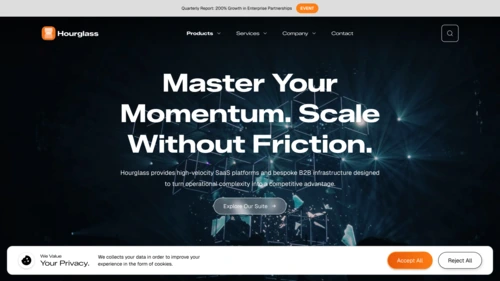

# Hourglass Corporate - Site Template for Drupal CMS

**Hourglass Corporate** is a high-performance corporate site template for Drupal CMS, purpose-built for B2B and SaaS organisations. It delivers a complete, production-ready marketing website out of the box — with a bold orange brand palette, enterprise-grade page sections, and a rich component library — all powered by [Canvas](https://www.drupal.org/project/canvas) and [Single Directory Components (SDC)](https://www.drupal.org/docs/develop/theming-drupal/using-single-directory-components).

No build tools required. Install and launch.

---

## Key Features

- **SDC Components** — Hero, Key Features Slider, Stats Section, Offerings Slider, Services Grid, Product Grid, Blog Listing, Team Section, FAQ, History Timeline, Logo Carousel, News & Events, Video Feature, Contact Cards, CTA Banner, and more.
- **Canvas page builder integration** — Every component is a Canvas block. Build and edit pages visually without writing code.
- **Corporate design system** — Consistent orange brand palette built on CSS custom properties. Rebrand with a single token override.
- **Fully responsive** — Mobile-first layouts tested at 768px, 1024px, and 1200px.
- **Zero build tooling** — Vanilla CSS and vanilla JavaScript. No Node.js, no Webpack, no Tailwind.
- **Content types included** — Blog with listing, search, and detail views; Career pages; Product and Service pages; Team profiles.
- **Accessible markup** — Semantic HTML with ARIA attributes and keyboard navigation throughout.
- **Drupal 11 ready** — Requires Drupal `^11.3`.

---

## Requirements

- PHP 8.3+
- Drupal 11.3 or higher
- [Canvas](https://www.drupal.org/project/canvas) module
- [CVA](https://www.drupal.org/project/cva) module

---

## What's Included

### Page Templates
| Page | Path |
|---|---|
| Home | `/home-page` |
| Products | `/products` |
| Services | `/services` |
| Blogs | `/blogs` |
| Careers | `/careers` |
| About Us | `/about-us` |
| Contact | `/contact` |

### Content Types
- **Blog** — with listing, search, and individual post views
- **Page** — flexible Canvas-powered pages for all marketing sections

### Theme
The **Hourglass INC** theme (`drupal/hourglass`) is automatically installed and set as the default theme. The admin theme is **Gin**.

---

## Customisation

### Brand colours
All colours are defined as CSS custom properties in `web/themes/custom/hourglass/components/base/colors/colors.css`. Override the orange palette by updating `--brand-primary` and related tokens.

### Adding components
Each component lives in its own Single Directory Component folder under `web/themes/custom/hourglass/components/`. Add new components by following the same pattern: a `.twig` template, a `.css` file, a `.component.yml` schema, and a corresponding entry in `hourglass.libraries.yml`.

---

## Support

- **Issue queue:** [drupal.org/project/hourglass_inc](https://www.drupal.org/project/hourglass_inc)
- **Drupal Slack:** `#hourglass_inc` channel in [Drupal Slack](https://drupal.org/slack)
- **Documentation:** [drupal.org/docs](https://www.drupal.org/docs)
